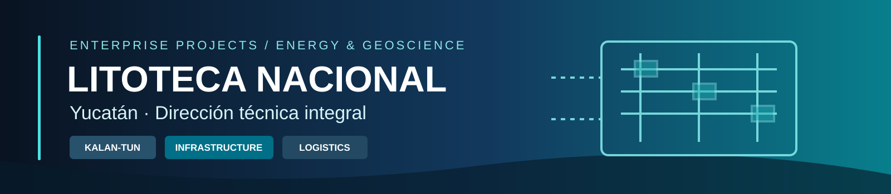

# Litoteca Nacional de la Industria de Hidrocarburos · Sede Yucatán

### Caso de estudio profesional · Gerencia técnica de proyecto integral

**Coordinación de software técnico y administrativo, infraestructura tecnológica, logística de traslado de muestras y actividades de negociación para un proyecto geocientífico de gran escala.**

> **Rol declarado:** Gerente Técnico en Plenumsoft Energy & Sustainability. Trabajo coordinado con el director, tres líderes de proyecto y equipos de desarrollo e instalación. Las responsabilidades personales se describen a partir del testimonio del autor; las características del proyecto se basan en una presentación corporativa de noviembre de 2019.

## Contexto

La presentación **«Litoteca Nacional Yucatán PCTY»**, preparada para una visita al IMP el 22 de noviembre de 2019, documenta el proyecto de la Litoteca Nacional de la Industria de Hidrocarburos, sede Yucatán, desarrollado por el **Consorcio Geocientífico Yucatán**.

El proyecto contempló un centro especializado para el resguardo y consulta de muestras geológicas y la prestación de servicios como cortes de muestras, elaboración de láminas delgadas e imágenes digitales de alta resolución (págs. 2–6).

## Mi responsabilidad: Gerencia Técnica

Durante mi participación en Plenumsoft, desempeñé funciones de **Gerente Técnico del proyecto integral**, en coordinación con el director, tres líderes de proyecto y los equipos de desarrollo de software e instalación.

Las áreas bajo mi coordinación incluyeron:

- **Software técnico:** gestión de información de muestras, trazabilidad y servicios.
- **Software administrativo:** procesos de operación, recursos y control administrativo.
- **Infraestructura:** servidores, almacenamiento, telecomunicaciones, seguridad y control de acceso.
- **Logística:** coordinación de actividades asociadas al traslado y organización de muestras.
- **Gestión de proyecto:** negociaciones y participación coordinada en la evaluación de proveedores, propuestas técnicas y presupuestos.

**No se atribuye al autor la ejecución individual de estas actividades ni decisiones exclusivas de contratación o presupuesto.** El trabajo fue multidisciplinario y coordinado.

## Componentes del proyecto

| Componente | Alcance documentado | Detalle |
| --- | --- | --- |
| **Kalan-Tun** | Sistema técnico y administrativo para la operación de litotecas | [Software y procesos](docs/KALAN-TUN.md) |
| **Traslado de muestras** | Plan de traslado, control, validación, seguimiento y resguardo | [Logística y trazabilidad](docs/TRASLADO-Y-TRAZABILIDAD.md) |
| **Infraestructura tecnológica** | CCTV, control de acceso, conectividad, servidores y redes | [Infraestructura](docs/INFRAESTRUCTURA.md) |

### Kalan-Tun: información y operación

La presentación describe una plataforma para centralizar y ordenar información de muestras, apoyar la integridad de datos y la trazabilidad de estudios, facilitar servicios básicos y cubrir procesos administrativos. También muestra una propuesta de arquitectura de integración de información estructurada y no estructurada (págs. 14–22).

**Importante:** algunas diapositivas expresan funciones en futuro o como arquitectura «a utilizarse». En este caso de estudio se distinguen **capacidades descritas** de **propuestas**, sin afirmar que todos los módulos o componentes se desplegaron.

### Traslado y control de muestras

La documentación incluye un plan de traslado de **183,002 cajas**: 59,346 desde Ciudad del Carmen y 123,656 desde Comalcalco (pág. 11). Esta cifra es el **volumen indicado en el plan**, no una medición independiente de cajas efectivamente trasladadas ni un resultado atribuible exclusivamente al software.

El flujo descrito incluye importación de datos, configuración de transporte, validación de carga, seguimiento de vehículos y resguardo (págs. 9–13).

### Infraestructura especializada

Se documentan proyectos de CCTV, control de acceso, enlace de datos con CNH/CNIH y equipamiento de servidores, almacenamiento y redes (págs. 24–28). La presentación afirma la instalación de **38 cámaras**; otros elementos se describen como especificaciones o componentes contemplados.

## Evidencia y alcance

- **Fuente principal:** presentación corporativa de 30 páginas, *Presentacion_Litoteca_paravisitaIMP_22112019.pdf*.
- **Responsabilidades personales:** confirmadas por el autor de este portafolio.
- **Código fuente:** no disponible en este repositorio.
- **Métricas:** se conservan las cifras y su contexto documental; no se inventan indicadores de impacto.
- **Material corporativo:** no se redistribuyen el PDF, logos ni capturas originales sin revisión de permisos.

Consulta [fuentes, límites y pendientes](docs/FUENTES-Y-ALCANCE.md).

## Naturaleza de este repositorio

Este repositorio es un **caso de estudio profesional**, no una distribución del software Kalan-Tun, ni un repositorio de código de infraestructura. No incluye datos de muestras, información operativa confidencial, credenciales, configuraciones de seguridad ni código propietario.

---

[← Perfil profesional](https://github.com/isaiassolis)
