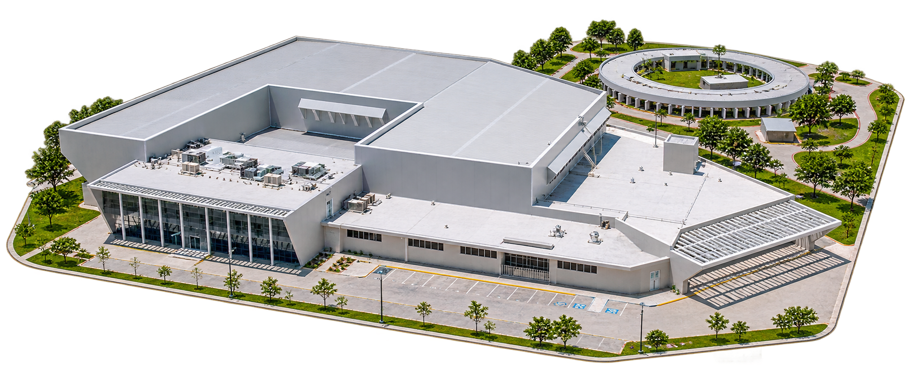
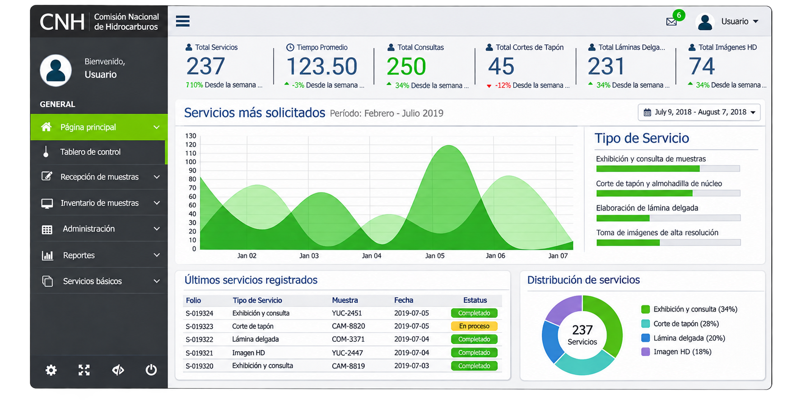

# Litoteca Nacional de la Industria de Hidrocarburos · Sede Yucatán

**Gerencia técnica integral · Software, infraestructura, logística y coordinación multidisciplinaria**

Durante mi etapa en **Plenumsoft Energy & Sustainability**, participé como **Gerente Técnico del proyecto integral de la Litoteca Nacional de la Industria de Hidrocarburos, sede Yucatán**. Trabajé con la dirección, **tres líderes de proyecto** y los equipos responsables de desarrollo de software, infraestructura e instalación.

La Litoteca Nacional Yucatán **fue inaugurada el 26 de junio de 2019** y se convirtió en un centro especializado para el resguardo, organización y consulta de muestras geológicas e información de la industria de hidrocarburos.

Este proyecto es representativo de mi experiencia en **dirección tecnológica más allá del software**: coordinación de equipos, sistemas, infraestructura, logística y proveedores.

## El proyecto

La sede Yucatán integra muestras físicas con información digital para apoyar la consulta, conservación e investigación geológica. Al momento de su inauguración, la CNH informó que la instalación resguardaba **alrededor de 183 mil cajas de muestras** y tenía **capacidad para un millón de cajas**.

El proyecto contó con la participación de varias instituciones y empresas, entre ellas Plenumsoft Energy & Sustainability.

*Ilustración recreada del proyecto; no es una fotografía de las instalaciones.*

## Mi participación

Como **Gerente Técnico del proyecto integral**, coordiné actividades en diferentes áreas junto con la dirección y los líderes de proyecto:

- **Software técnico:** gestión de información de muestras, consulta y trazabilidad de estudios.
- **Software administrativo:** procesos de operación, administración y control.
- **Infraestructura:** servidores, almacenamiento, redes, conectividad, videovigilancia y control de acceso.
- **Logística:** coordinación del componente relacionado con traslado, organización y resguardo de muestras.
- **Gestión de proyecto:** seguimiento técnico, evaluación de proveedores, propuestas, presupuestos y participación en negociaciones.

El principal reto de esta responsabilidad fue **integrar disciplinas y equipos con necesidades técnicas y operativas distintas**.

## Sistemas y componentes

| Componente | Trabajo y funcionalidad | Detalle |
| --- | --- | --- |
| **Kalan-Tun** | Plataforma de información técnica y administración para la litoteca. | [Software y procesos](docs/KALAN-TUN.md) |
| **Traslado y trazabilidad** | Organización, control y seguimiento de muestras y su movimiento. | [Logística y trazabilidad](docs/TRASLADO-Y-TRAZABILIDAD.md) |
| **Infraestructura tecnológica** | Seguridad, conectividad, servidores, almacenamiento y redes. | [Infraestructura](docs/INFRAESTRUCTURA.md) |

### Kalan-Tun

Participé en la coordinación del frente de software relacionado con **Kalan-Tun**, diseñado para apoyar la gestión de información de muestras, trazabilidad de estudios, servicios y necesidades administrativas de la litoteca.

*Recreación visual basada en una captura histórica; puede diferir de la interfaz original.*

### Traslado de muestras

La operación requirió trasladar y organizar un importante acervo de muestras geológicas procedentes de otras instalaciones. El plan técnico que trabajamos contemplaba **183,002 cajas** desde Ciudad del Carmen y Comalcalco, mientras que la información pública de la inauguración confirma que la sede Yucatán ya resguardaba aproximadamente **183 mil cajas** en junio de 2019.

Mi participación se centró en la **coordinación del componente tecnológico y logístico**, junto con los responsables de los demás frentes de trabajo.

[Conocer el traslado y la trazabilidad](docs/TRASLADO-Y-TRAZABILIDAD.md)

### Infraestructura especializada

El proyecto incorporó sistemas de seguridad física, videovigilancia, conectividad, almacenamiento y redes. La documentación técnica registra la instalación de **38 cámaras de videovigilancia**, además de otras soluciones de infraestructura contempladas para el funcionamiento de la sede.

[Conocer la infraestructura tecnológica](docs/INFRAESTRUCTURA.md)

## Lo que representa en mi trayectoria

Mi participación en la Litoteca Nacional Yucatán consolidó experiencia en **gerencia técnica integral**, al coordinar software, infraestructura, logística y proveedores en un proyecto industrial ejecutado.

Trabajé con profesionales de distintas disciplinas y coordiné la articulación entre las necesidades operativas y las soluciones tecnológicas.

## El proyecto en medios

- [El Financiero — Yucatán tiene la litoteca con las mejores prácticas del mundo (26 de junio de 2019)](https://www.elfinanciero.com.mx/peninsula/yucatan-tiene-la-litoteca-con-las-mejores-practicas-del-mundo/)
- [Comisión Nacional de Hidrocarburos — Inauguración de la Litoteca Nacional, sede Yucatán](https://www.gob.mx/cnh/prensa/comunicado-de-prensa-002-emitido-por-la-cnh?idiom=es)

## Sobre las imágenes y el proyecto

Las imágenes incluidas son recreaciones para ilustrar el caso. El proyecto fue desarrollado por un consorcio de organizaciones y sus tecnologías pertenecen a sus respectivos titulares. Este repositorio presenta mi participación profesional sin distribuir software ni datos internos.

---

[← Volver a mi portafolio profesional](https://github.com/isaiassolis)
