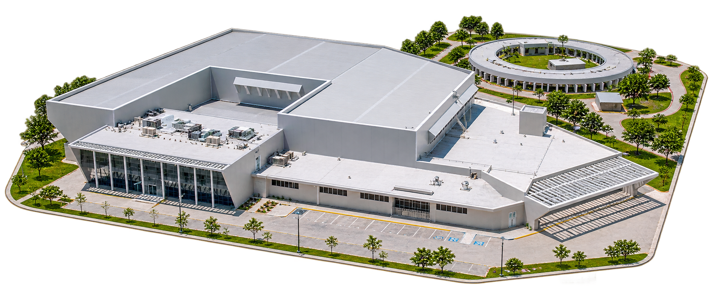

# Infraestructura tecnológica de la Litoteca Nacional Yucatán

**Coordinación técnica de seguridad, conectividad, servidores y proveedores**

*Recreación visual del proyecto; no es una fotografía de las instalaciones originales.*

## El desafío

La Litoteca requirió infraestructura para apoyar la consulta de información geológica, el trabajo de especialistas, la conectividad, el almacenamiento y la seguridad física y tecnológica de sus instalaciones.

## Componentes

| Área | Solución |
| --- | --- |
| **Videovigilancia** | Instalación documentada de **38 cámaras** y sistema de grabación en red. |
| **Control de acceso** | Sistemas de lectores, controladores y cerraduras para administrar el acceso a áreas específicas. |
| **Conectividad** | Soluciones de enlace de datos con CNH/CNIH. |
| **Servidores y almacenamiento** | Equipamiento empresarial para servicios, virtualización y resguardo digital. |
| **Redes** | Seguridad perimetral, conmutadores y conectividad inalámbrica. |
| **Equipos de usuario** | Estaciones de trabajo y equipos para necesidades técnicas y administrativas. |

El proyecto se ejecutó y culminó en la inauguración de la sede Yucatán el **26 de junio de 2019**. La documentación técnica incluye, además de las instalaciones registradas, especificaciones de equipamiento y arquitectura de sus diferentes componentes.

## Mi participación

Desde la **Gerencia Técnica**, coordiné actividades de infraestructura, instalación y proveedores junto con la dirección del proyecto, tres líderes y equipos técnicos especializados.

El trabajo combinó **gestión de infraestructura, evaluación de soluciones, coordinación de especialistas y seguimiento técnico** dentro de una instalación industrial.

[← Volver al proyecto](../README.md)
