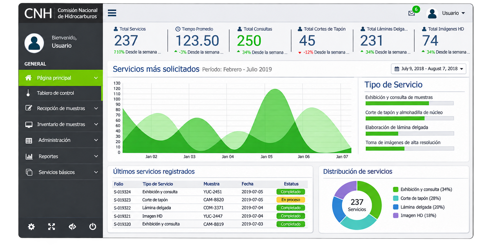

# Kalan-Tun — Sistema técnico y administrativo para la Litoteca

**Gestión de información de muestras y procesos de operación**

*Ilustración basada en una captura histórica; los textos y valores pueden diferir de la interfaz original.*

## El desafío

La operación de la Litoteca requería conectar las muestras geológicas con sus registros, estudios, servicios y procedimientos administrativos. La información debía poder consultarse y organizarse sin perder la relación con los materiales físicos.

## La solución

**Kalan-Tun** formó parte de los sistemas tecnológicos desarrollados para apoyar la operación de la Litoteca Nacional Yucatán.

El trabajo de software comprendió funciones de gestión de información, incluyendo:

- Centralización y organización de información de muestras.
- Validación e integridad de registros.
- Búsqueda y consulta de datos técnicos.
- Trazabilidad de estudios y servicios asociados a muestras.
- Gestión de solicitudes y flujos de información.

También se diseñaron capacidades administrativas relacionadas con usuarios, permisos, activos, almacén, compras, contabilidad y tesorería.

En la evolución tecnológica del proyecto se contemplaron integración de información estructurada y no estructurada, gestión de imágenes de alta resolución y líneas de analítica y procesamiento de imágenes.

## Mi participación

Como **Gerente Técnico del proyecto integral**, coordiné el frente de software junto con la dirección y los líderes responsables, procurando su integración con los procesos operativos y la infraestructura tecnológica.

[← Volver al proyecto](../README.md)
